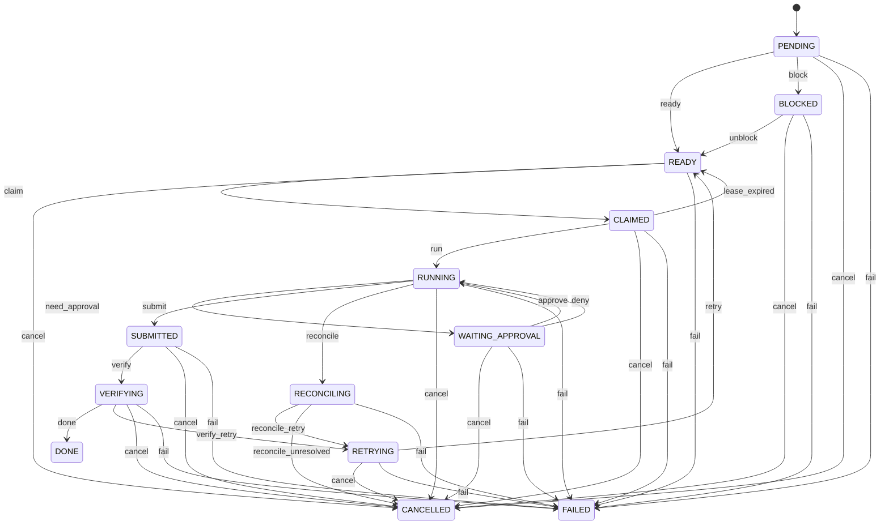

<!-- Generated by gen.go from job_states.yaml. DO NOT EDIT. -->

# Job 状态机（§5.2）

初始状态：`PENDING`。终态：`DONE`、`CANCELLED`、`FAILED`。

## 状态图

## 迁移表

| 当前状态 | 事件 | 下一状态 |
|---|---|---|
| PENDING | ready | READY |
| PENDING | block | BLOCKED |
| BLOCKED | unblock | READY |
| READY | claim | CLAIMED |
| CLAIMED | run | RUNNING |
| CLAIMED | lease_expired | READY |
| RUNNING | need_approval | WAITING_APPROVAL |
| WAITING_APPROVAL | approve | RUNNING |
| WAITING_APPROVAL | deny | RUNNING |
| RUNNING | submit | SUBMITTED |
| SUBMITTED | verify | VERIFYING |
| VERIFYING | done | DONE |
| VERIFYING | verify_retry | RETRYING |
| RETRYING | retry | READY |
| RUNNING | reconcile | RECONCILING |
| RECONCILING | reconcile_retry | RETRYING |
| RECONCILING | reconcile_unresolved | CANCELLED |
| PENDING | cancel | CANCELLED |
| BLOCKED | cancel | CANCELLED |
| READY | cancel | CANCELLED |
| CLAIMED | cancel | CANCELLED |
| RUNNING | cancel | CANCELLED |
| WAITING_APPROVAL | cancel | CANCELLED |
| SUBMITTED | cancel | CANCELLED |
| VERIFYING | cancel | CANCELLED |
| RETRYING | cancel | CANCELLED |
| PENDING | fail | FAILED |
| BLOCKED | fail | FAILED |
| READY | fail | FAILED |
| CLAIMED | fail | FAILED |
| RUNNING | fail | FAILED |
| RECONCILING | fail | FAILED |
| WAITING_APPROVAL | fail | FAILED |
| SUBMITTED | fail | FAILED |
| VERIFYING | fail | FAILED |
| RETRYING | fail | FAILED |

> 未在表中的 (状态, 事件) 组合一律被状态机显式拒绝（Next 返回 false），不产生迁移。
