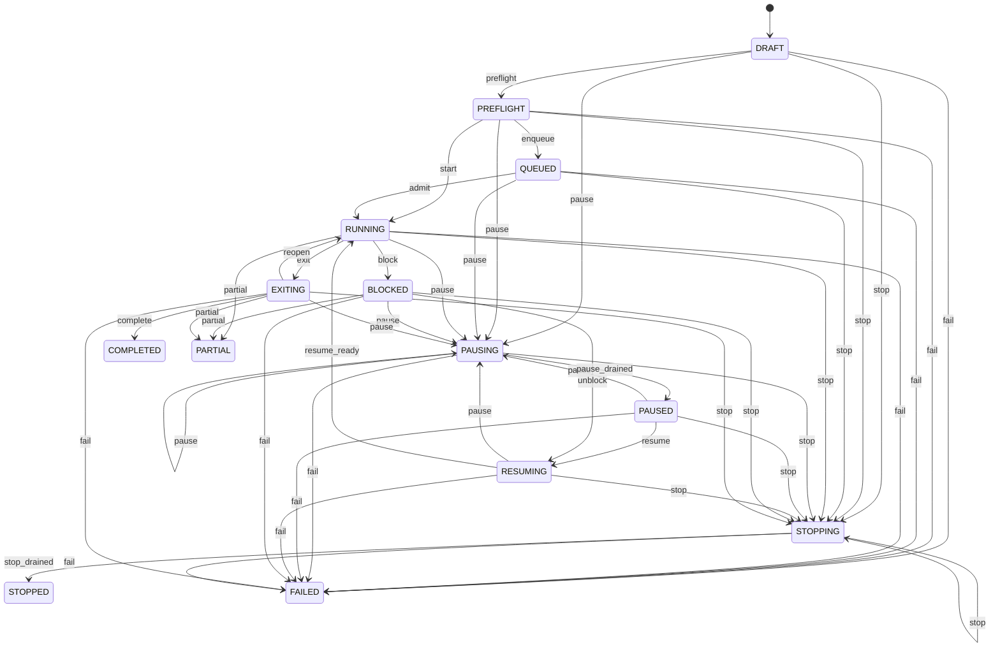

<!-- Generated by gen.go from states.yaml. DO NOT EDIT. -->

# Run 状态机（§5.1）

初始状态：`DRAFT`。终态：`COMPLETED`、`PARTIAL`、`STOPPED`、`FAILED`。

## 状态图

## 迁移表

| 当前状态 | 事件 | 下一状态 |
|---|---|---|
| DRAFT | preflight | PREFLIGHT |
| PREFLIGHT | enqueue | QUEUED |
| PREFLIGHT | start | RUNNING |
| QUEUED | admit | RUNNING |
| DRAFT | pause | PAUSING |
| PREFLIGHT | pause | PAUSING |
| QUEUED | pause | PAUSING |
| RUNNING | pause | PAUSING |
| PAUSING | pause | PAUSING |
| PAUSED | pause | PAUSING |
| RESUMING | pause | PAUSING |
| BLOCKED | pause | PAUSING |
| EXITING | pause | PAUSING |
| PAUSING | pause_drained | PAUSED |
| PAUSED | resume | RESUMING |
| RESUMING | resume_ready | RUNNING |
| RUNNING | block | BLOCKED |
| BLOCKED | unblock | RESUMING |
| RUNNING | exit | EXITING |
| EXITING | reopen | RUNNING |
| EXITING | complete | COMPLETED |
| RUNNING | partial | PARTIAL |
| BLOCKED | partial | PARTIAL |
| EXITING | partial | PARTIAL |
| STOPPING | stop_drained | STOPPED |
| DRAFT | stop | STOPPING |
| PREFLIGHT | stop | STOPPING |
| QUEUED | stop | STOPPING |
| RUNNING | stop | STOPPING |
| PAUSING | stop | STOPPING |
| PAUSED | stop | STOPPING |
| RESUMING | stop | STOPPING |
| BLOCKED | stop | STOPPING |
| EXITING | stop | STOPPING |
| STOPPING | stop | STOPPING |
| DRAFT | fail | FAILED |
| PREFLIGHT | fail | FAILED |
| QUEUED | fail | FAILED |
| RUNNING | fail | FAILED |
| PAUSING | fail | FAILED |
| PAUSED | fail | FAILED |
| RESUMING | fail | FAILED |
| BLOCKED | fail | FAILED |
| EXITING | fail | FAILED |
| STOPPING | fail | FAILED |

> 未在表中的 (状态, 事件) 组合一律被状态机显式拒绝（Next 返回 false），不产生迁移。
