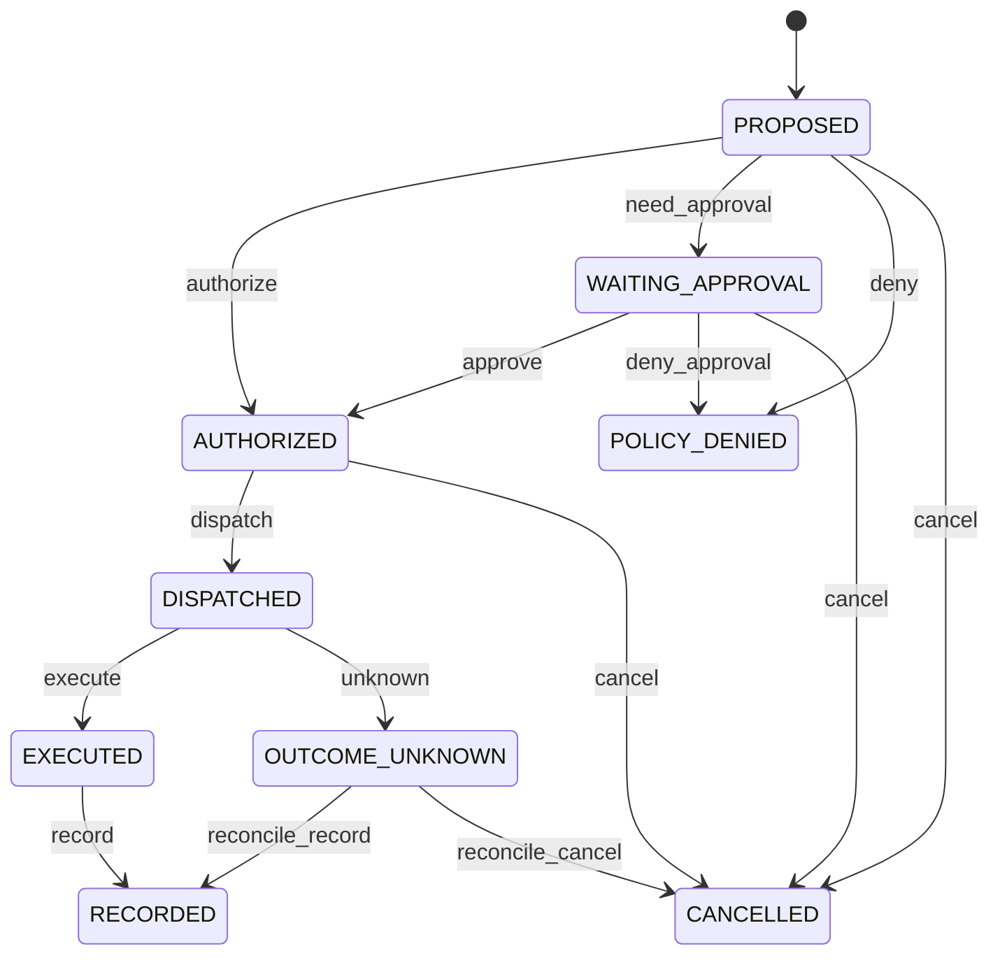

<!-- Generated by gen.go from action_states.yaml. DO NOT EDIT. -->

# Action 状态机（§5.3）

初始状态：`PROPOSED`。终态：`POLICY_DENIED`、`RECORDED`、`CANCELLED`。

## 状态图

## 迁移表

| 当前状态 | 事件 | 下一状态 |
|---|---|---|
| PROPOSED | authorize | AUTHORIZED |
| PROPOSED | need_approval | WAITING_APPROVAL |
| PROPOSED | deny | POLICY_DENIED |
| WAITING_APPROVAL | approve | AUTHORIZED |
| WAITING_APPROVAL | deny_approval | POLICY_DENIED |
| AUTHORIZED | dispatch | DISPATCHED |
| DISPATCHED | execute | EXECUTED |
| EXECUTED | record | RECORDED |
| DISPATCHED | unknown | OUTCOME_UNKNOWN |
| OUTCOME_UNKNOWN | reconcile_record | RECORDED |
| OUTCOME_UNKNOWN | reconcile_cancel | CANCELLED |
| PROPOSED | cancel | CANCELLED |
| WAITING_APPROVAL | cancel | CANCELLED |
| AUTHORIZED | cancel | CANCELLED |

> 未在表中的 (状态, 事件) 组合一律被状态机显式拒绝（Next 返回 false）。
